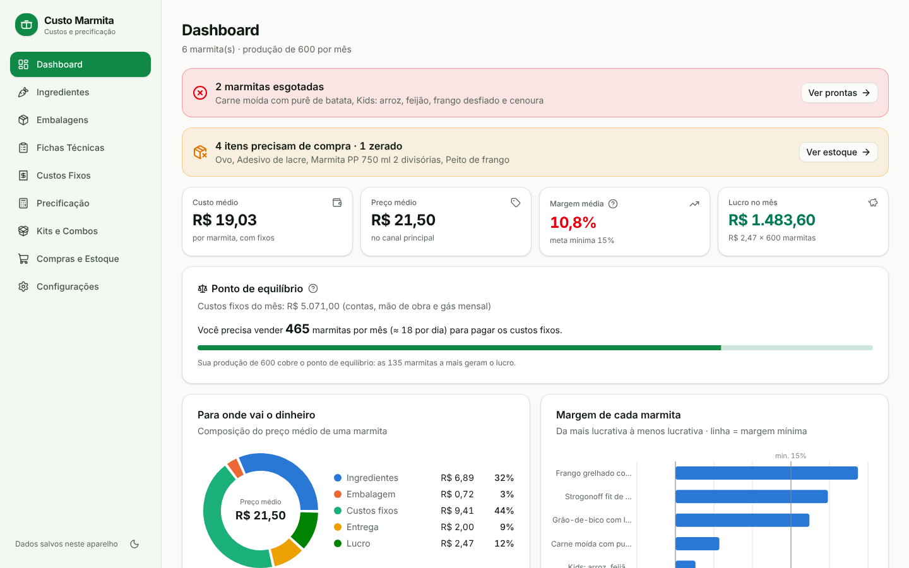
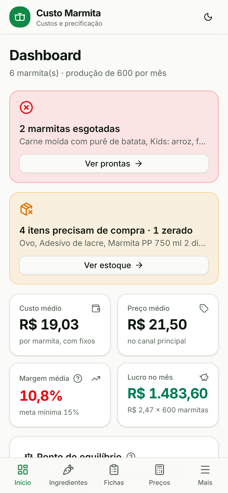
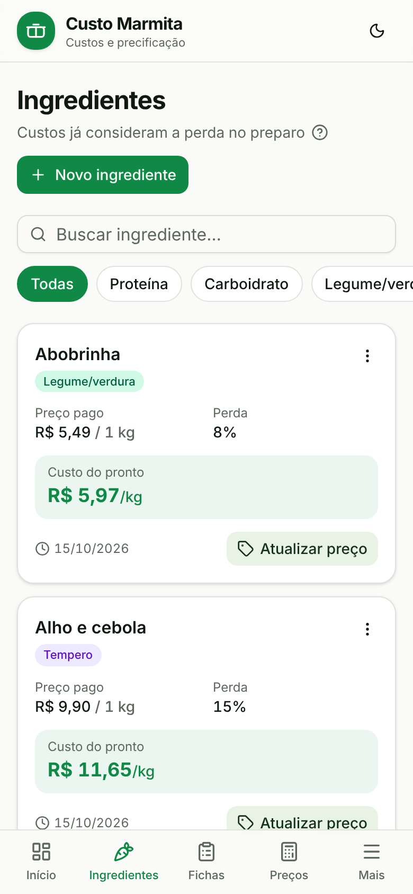
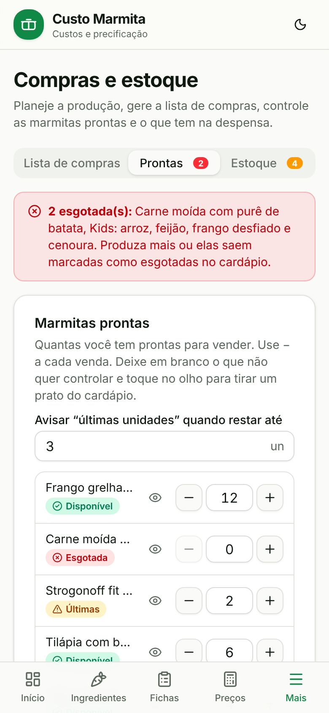
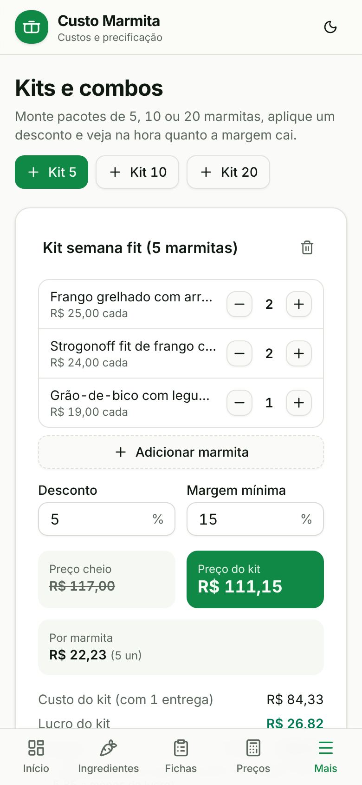
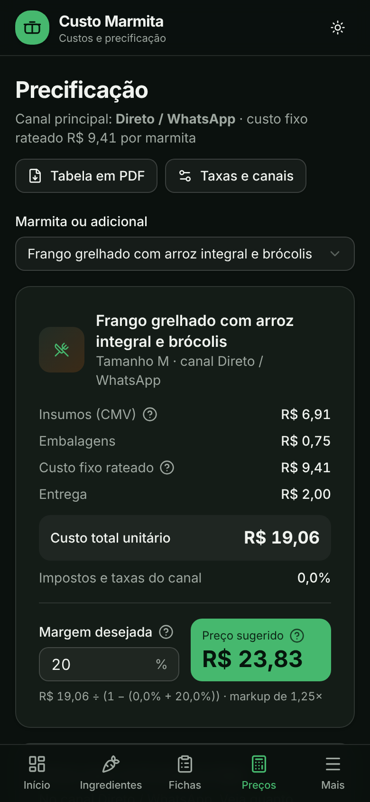
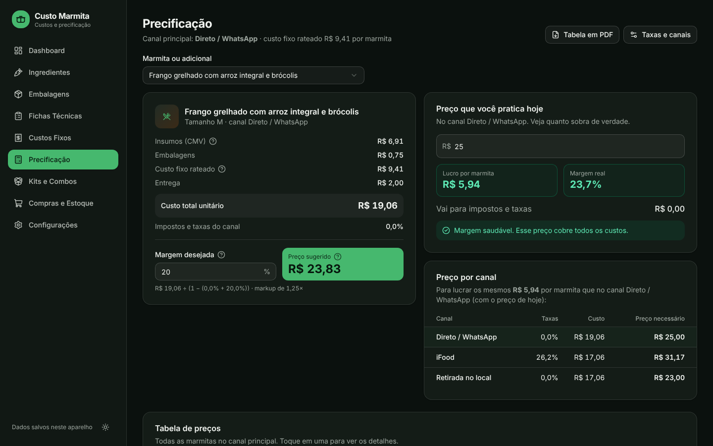
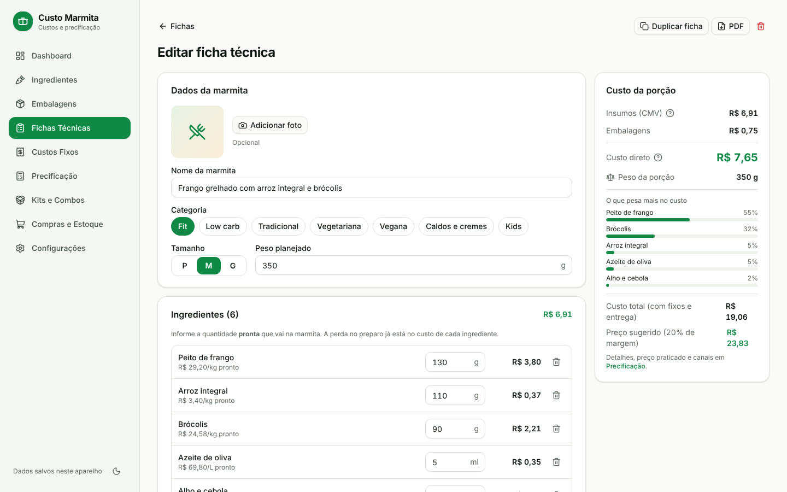
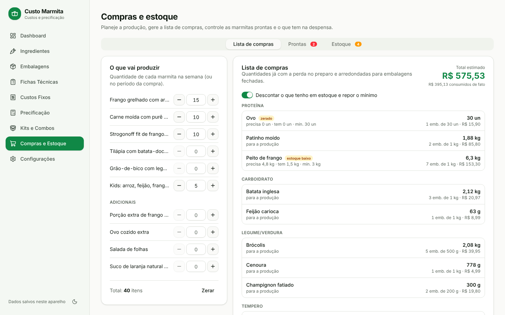

<div align="center">

# 🍱 Custo Marmita

**Calculadora completa de custos e precificação para quem vende marmitas: fit, tradicionais e congeladas.**

Feita para usar no celular, na cozinha.

[**▶ Abrir o app**](https://custo-marmita.vercel.app/)




</div>

## O problema

Quem vende marmita costuma definir o preço "de olho": soma o frango e o arroz, coloca uma margem e pronto. Na prática, uma porção de custos fica de fora:

- O **frango perde ~25%** do peso no cozimento, enquanto o **arroz rende 2,5×** depois de pronto. O custo por grama do alimento pronto é bem diferente do preço de compra.
- **Pote, tampa, etiqueta e lacre** somam R$ 0,50 a R$ 1,00 por marmita.
- **Aluguel, gás, luz, contador e o próprio salário** precisam ser divididos entre as marmitas do mês.
- **Maquininha, iFood e impostos** levam de 0% a 30% do preço, e cada canal precisa de um preço diferente para dar o mesmo lucro.

O resultado é vender bem e mesmo assim não sobrar dinheiro. O **Custo Marmita** calcula o custo real de cada prato e o preço certo, e avisa em vermelho quando uma marmita está dando prejuízo.

## Funcionalidades

| Área | O que faz |
|---|---|
| **Ingredientes** | Preço da embalagem, **fator de correção** (perda no preparo) e **índice de cocção** (arroz, feijão, massas). Calcula o custo por kg/L do alimento *pronto*. Atualização rápida de preço com **histórico e variação %**, mais aviso de preço desatualizado. |
| **Embalagens** | Capacidade (350 g, 500 g, 750 ml…), material, divisórias, micro-ondas/freezer e fornecedor. Calcula o custo unitário. Tem um **catálogo com ~25 embalagens** comuns para adicionar de uma vez. |
| **Fichas técnicas** | Receita de cada marmita com custo em tempo real: CMV, embalagem, peso da porção, "o que pesa mais no custo", foto, **duplicar ficha** e aviso quando a porção **não cabe no pote**. Inclui **adicionais** (proteína extra, salada, suco) e um **catálogo de pratos** com o cardápio real de uma marmitaria. |
| **Custos fixos** | Contas do mês, mão de obra (salário ou valor/hora × horas), **gás por botijão** e produção mensal. Faz o **rateio automático** por marmita. |
| **Taxas e canais** | Imposto, maquininha (Pix/débito/crédito), entrega própria e canais de venda (WhatsApp, iFood, Retirada), cada um com sua comissão. |
| **Precificação** | Preço sugerido pelo **markup**, preço praticado com **lucro e margem real**, alertas de prejuízo e de margem abaixo da meta, **preço por canal mantendo o mesmo lucro** e tabela de preços. |
| **Kits e combos** | Kits de 5, 10 ou 20 marmitas com desconto. Mostra **quanto a margem cai** e sugere o **desconto máximo** que mantém a margem mínima. |
| **Compras e estoque** | **Lista de compras** gerada a partir do plano de produção (já com a perda, em embalagens fechadas) e enviada para o **WhatsApp**. **Estoque** com mínimo e alertas, entrada da compra e baixa da produção. |
| **Marmitas prontas** | Controle das marmitas prontas para venda, alerta de **esgotadas** e **cardápio do dia** para WhatsApp/Instagram marcando ✅ disponível, ⚠️ últimas unidades e ❌ esgotado. |
| **Dashboard** | Custo, preço e margem médios, **lucro estimado no mês**, **ponto de equilíbrio**, composição do preço (gráfico de rosca), margem de cada marmita (barras) e rankings de mais lucrativas e de que precisam de reajuste. |
| **Extras** | **PDF** da ficha técnica e da tabela de preços, **modo escuro**, **backup em JSON** (exportar/importar), dados de exemplo com botão de limpar, tooltips com os termos explicados em linguagem simples e validação de todos os campos. |

## Telas

| Celular | | |
|---|---|---|
|  |  |  |
|  |  | |





## As contas por trás

Toda a lógica de cálculo fica em **funções puras** em [`src/lib/calc`](src/lib/calc), separadas da interface e cobertas por testes.

```text
Custo do pronto (R$/g)  = preço da embalagem ÷ (quantidade × (1 − perda%) × índice de cocção)
Custo fixo por marmita  = (contas + mão de obra + gás mensal) ÷ produção do mês  [+ botijão ÷ marmitas que rende]
Custo total unitário    = ingredientes + embalagens + custo fixo rateado + entrega
Preço sugerido (markup) = custo ÷ (1 − (impostos% + taxas% + margem%))
Margem real             = (preço − taxas − custo) ÷ preço
Preço no canal X        = (custo no canal + lucro desejado em R$) ÷ (1 − taxas do canal)
Desconto máximo do kit  = 1 − custo ÷ (preço cheio × (1 − taxas − margem mínima))
Ponto de equilíbrio     = custos fixos do mês ÷ margem de contribuição média
```

As divisões são protegidas contra zero (quantidade ou produção zerada) e o app avisa quando impostos, taxas e margem somam 100% ou mais.

## Tecnologias

- **React 19 + TypeScript** (strict) com **Vite**
- **Tailwind CSS 4** + **shadcn/ui** (Radix UI) + ícones **lucide**
- **Zustand** com persistência em `localStorage`, formato versionado com migração e backup em JSON
- **React Router** (rotas com hash e telas carregadas sob demanda)
- **Recharts** para os gráficos, com paleta validada para daltonismo nos modos claro e escuro
- **jsPDF + AutoTable** para os PDFs, carregados só quando usados
- **Vitest**: 84 testes cobrindo cálculos, estoque, lista de compras, kits, cardápio e backup
- Deploy contínuo na **Vercel** e no **GitHub Pages** (GitHub Actions)

## Como rodar localmente

Pré-requisito: **Node.js 20+**.

```bash
git clone https://github.com/Augustodevv/custo-marmita.git
cd custo-marmita
npm install
npm run dev        # abre em http://localhost:5173
```

Outros comandos:

```bash
npm test           # testes (Vitest)
npm run build      # build de produção em dist/
npm run preview    # serve o build localmente
npm run lint       # oxlint
npm run format     # prettier
```

## Estrutura

```text
src/
├── lib/
│   ├── calc/          # regras de negócio puras + testes (*.test.ts)
│   ├── format.ts      # R$ 1.234,56, percentuais e datas em pt-BR
│   ├── pdf.ts         # geração dos PDFs
│   └── *-catalog.ts   # catálogos de embalagens e de pratos
├── store/             # estado global (Zustand), dados de exemplo
├── components/        # layout (menu lateral / barra inferior), shadcn/ui e componentes comuns
└── pages/             # uma pasta por tela
```

## Deploy

- **Vercel (principal):** [custo-marmita.vercel.app](https://custo-marmita.vercel.app/), publicado a cada push na `main`. A configuração está em [`vercel.json`](vercel.json).
- **GitHub Pages (espelho):** [augustodevv.github.io/custo-marmita](https://augustodevv.github.io/custo-marmita/), publicado pelo workflow [`deploy.yml`](.github/workflows/deploy.yml), que também roda os testes.

## Próximos passos

- Login e sincronização entre aparelhos (hoje os dados ficam no aparelho, com backup em JSON)
- Cardápio público online com atualização automática de esgotados
- Tabela nutricional por ficha técnica

---

Feito por [**Augusto Novaes**](https://github.com/Augustodevv).
